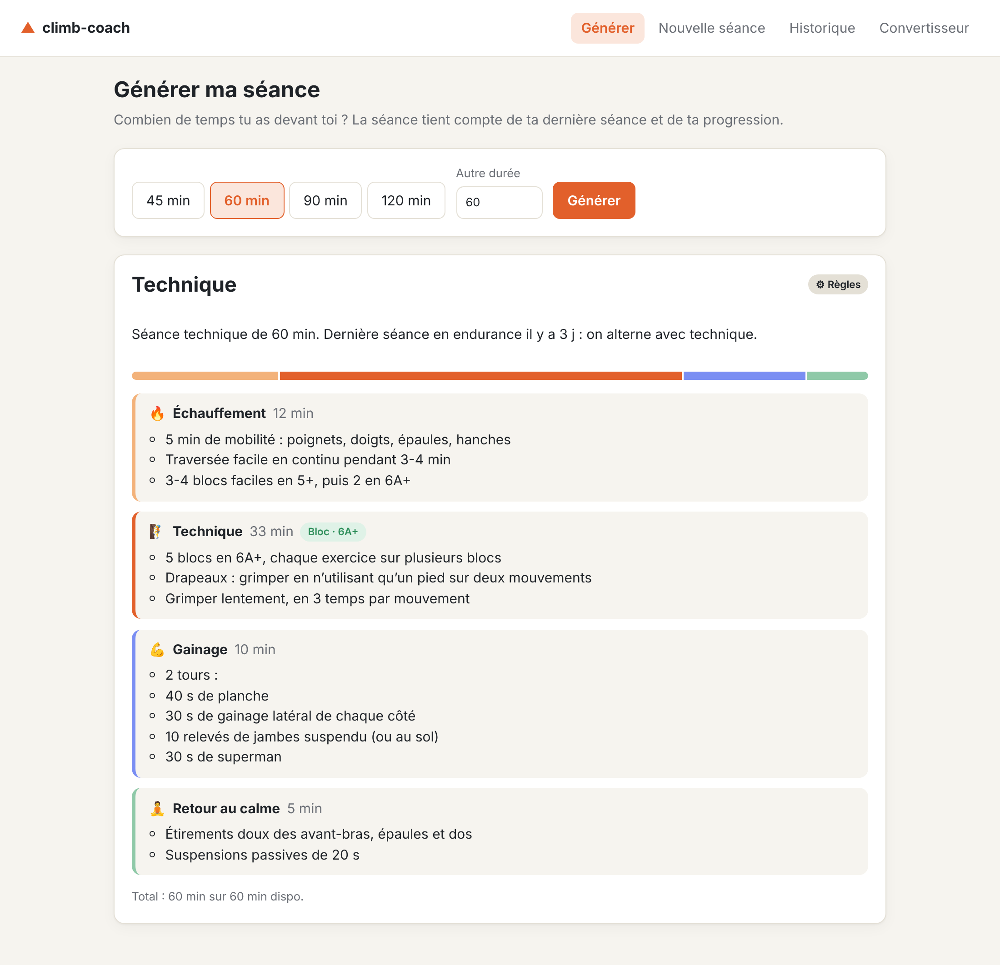
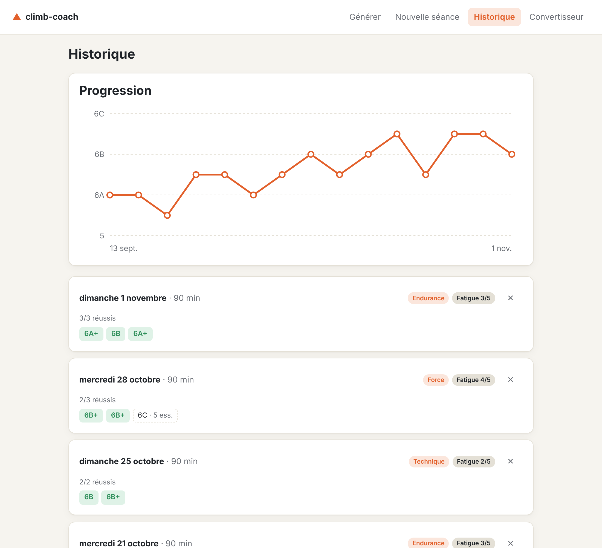
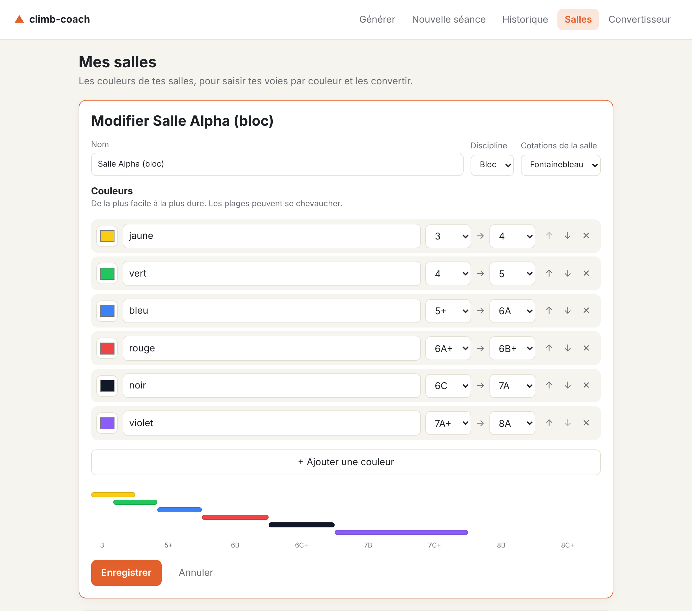
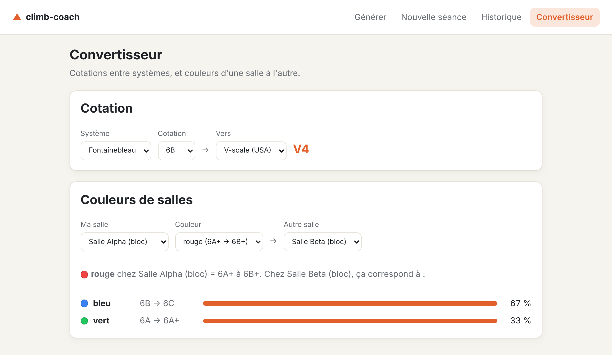
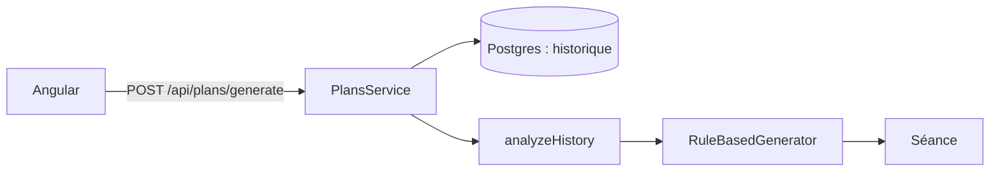

# climb-coach

Je grimpe plusieurs fois par semaine et je ne savais jamais quoi faire en arrivant à la salle. **climb-coach** suit mes séances et, le jour J, me génère la séance du jour à partir de **la séance précédente** et du **temps que j'ai devant moi**.



## Ce que fait l'appli

- **Suivi des séances** : type (force, endurance, technique), durée, fatigue ressentie, et chaque voie ou bloc tenté, saisi **par sa cotation ou par sa couleur de salle**.
- **Génération de la séance du jour** : je donne le temps dispo, l'appli propose échauffement, cœur de séance, gainage et retour au calme, en tenant compte de :
  - l'alternance des types de travail (force → endurance → technique) ;
  - le repos depuis la dernière séance et la fatigue (séance allégée si besoin, reprise en douceur après 2 semaines d'arrêt) ;
  - la progression (2 réussites au niveau max → on vise un cran au-dessus).
- **Règles pour la séance, Mistral pour le planning** : la séance du jour est construite par un **générateur à règles** déterministe. **Mistral** ne sert qu'au planning du mois, parce qu'il lit les notes de séance (douleurs, blessures) ; sa réponse est validée, et les règles prennent le relais au moindre problème.
- **Mes salles** : chaque salle se configure depuis l'interface (nom, discipline, système de cotation, couleurs et leurs plages), avec un aperçu des plages pour repérer trous et chevauchements.
- **Convertisseur** : cotations (française, YDS, Fontainebleau, V-scale) et **couleurs d'une salle à l'autre**.
- **Historique** avec courbe de progression.

| Historique               | Mes salles           | Convertisseur               |
| ------------------------ | -------------------- | --------------------------- |
|  |  |  |

## Stack

|              |                                                                                                |
| ------------ | ---------------------------------------------------------------------------------------------- |
| Front        | **Angular 20** (composants standalone, signals, formulaires réactifs, control flow `@if/@for`) |
| API          | **NestJS 11**, validation **zod** (env, body, réponses du LLM)                                 |
| Base         | **PostgreSQL** + **Drizzle ORM** (migrations SQL versionnées)                                  |
| IA           | **Mistral** via l'API `chat/completions` en mode JSON                                          |
| Lib partagée | `@climb-coach/grades`, TypeScript pur, utilisée par l'API **et** le front                      |
| Qualité      | Vitest, Jest, Supertest (e2e sur un vrai Postgres), Karma, ESLint, Prettier, GitHub Actions    |
| Déploiement  | Docker multi-étapes, docker compose, nginx                                                     |

## Architecture

```
climb-coach/
├── packages/grades/     Conversion de cotations et de couleurs (lib sans dépendance)
├── apps/api/            NestJS : séances, génération, conversions
│   ├── src/sessions/      CRUD + normalisation des cotations à la saisie
│   ├── src/gyms/          CRUD des salles et de leurs couleurs
│   ├── src/plans/         analyse de l'historique, générateur à règles, planning (Mistral)
│   ├── src/db/            schéma Drizzle, migrations, seed
│   └── test/              tests e2e
└── apps/web/            Angular : génération, saisie, historique, salles, convertisseur
```



### Quelques choix

- **Le LLM seulement là où il apporte quelque chose.** Pour la séance, Mistral ne faisait que recopier les formats proposés par les règles : il a été retiré. Il garde le planning du mois, où lire les notes libres compte. Sa réponse n'y est jamais crue sur parole (schéma zod, une relance, puis les règles).
- **Une échelle de référence par discipline.** Toutes les cotations sont stockées dans un seul système (française pour la voie, Font pour le bloc) avec une valeur numérique : la progression et les comparaisons deviennent triviales.
- **Une couleur = une plage.** Convertir une couleur d'une salle à l'autre renvoie plusieurs couleurs avec leur taux de recouvrement, pas une réponse unique fausse.
- **La lib de conversion est un package à part**, testée seule et importée par l'API et par le front (conversion instantanée côté navigateur, seules les salles viennent de l'API).
- **Les mêmes règles de validation partout.** Une salle est validée par `defineGym` de la lib, côté API avant l'enregistrement ; le front reprend les mêmes contrôles pour bloquer le bouton avant même l'appel.
- **Supprimer une salle ne casse pas l'historique.** Chaque voie est stockée avec sa cotation normalisée : la couleur n'est qu'une information de saisie.

## Lancer le projet

### Avec Docker

```bash
cp .env.example .env          # optionnel : ajouter MISTRAL_API_KEY
docker compose up --build
```

- Appli : http://localhost:8080
- API : http://localhost:3000/api

### En production

Docker Compose sur un VPS, accessible uniquement depuis tes appareils via Tailscale :
voir [docs/deploiement.md](docs/deploiement.md).

Sans clé Mistral, tout fonctionne avec le générateur à règles. Une clé gratuite s'obtient sur la console Mistral (offre Experiment).

### En local

Prérequis : Node 22, pnpm, et la base lancée avec `docker compose up -d db` (exposée sur le port **5433** pour ne pas gêner un Postgres déjà installé).

```bash
pnpm install
pnpm --filter @climb-coach/grades build
cp apps/api/.env.example apps/api/.env
pnpm --filter @climb-coach/api seed    # 8 semaines de séances de démo
pnpm --filter @climb-coach/api dev     # http://localhost:3000/api
pnpm --filter @climb-coach/web start   # http://localhost:4200
```

## Tests

```bash
pnpm test                                   # tous les tests unitaires
pnpm --filter @climb-coach/api test:e2e     # e2e (DATABASE_URL vers une base de test)
pnpm lint && pnpm typecheck
```

Plus de 120 tests : conversions et validation des salles, règles de génération, client et planning Mistral (fetch mocké), endpoints de bout en bout sur Postgres, composants Angular.

## API

| Méthode  | Route                               |                                                     |
| -------- | ----------------------------------- | --------------------------------------------------- |
| `GET`    | `/api/sessions`                     | Séances récentes avec leurs voies                   |
| `POST`   | `/api/sessions`                     | Nouvelle séance (voies par cotation ou par couleur) |
| `DELETE` | `/api/sessions/:id`                 |                                                     |
| `GET`    | `/api/sessions/stats/progression`   | Meilleure réussite par séance                       |
| `POST`   | `/api/plans/generate`               | `{ availableMinutes }` → séance générée             |
| `GET`    | `/api/grades/convert?grade&from&to` | Conversion de cotation                              |
| `GET`    | `/api/gyms`                         | Salles et leurs couleurs                            |
| `GET`    | `/api/gyms/:id/convert?color&to`    | Couleur → couleurs d'une autre salle                |

## Pistes

- Plusieurs grimpeurs (auth) et salles partagées entre eux
- Saisie rapide depuis le téléphone (PWA)
- Ajuster les seuils de progression à partir des données réelles
